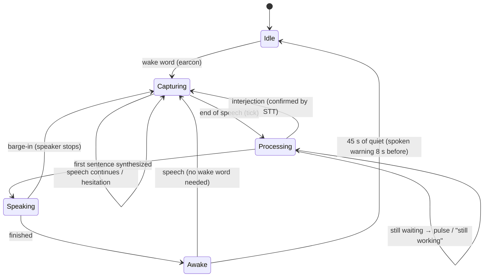

# offline_pocket_voice_assistant

Pocket-sized offline voice assistant for visually impaired users — built for privacy, portability, and low cost. It listens, understands, and speaks back locally with no cloud dependency, using a compact hardware setup designed for everyday carry.

This file describes the system **as it is now**. The reasoning behind decisions, past mistakes and open work are in
[docs/engineering_log.md](docs/engineering_log.md).

---

## What this does

A fully local voice assistant. It listens continuously, filters silence cheaply, detects a wake word, captures the
user's request, transcribes it, generates a streamed response and speaks it back — all on-device, no internet at
runtime.

Pipeline stages:

1. **WebRTC VAD** — continuous, cheap silence gate.
2. **openWakeWord** (ONNX backend) — scores only frames that contain speech; detects the wake word.
3. **Silero VAD** — precise speech start/end for captures, follow-ups and barge-in.
4. **Whisper STT** — persistent local HTTP server; also returns a confidence value.
5. **Gemma LLM** (llama.cpp) — persistent local HTTP server, **streamed** token by token.
6. **Kokoro TTS** — each sentence is synthesized while the LLM writes the next; one serialised speaker plays them.

Around that core: a software echo canceller (so it can be interrupted on loudspeakers), spoken/audible progress while
a slow model thinks, adaptive end-of-speech detection, offline-cached failure phrases, and a structured trace of
every state transition.

> The default system prompt is currently a **German tutor**; Whisper (`tiny.en`), the Kokoro voice and the cached
> phrases are still English. See "Language" in the design doc before relying on German speech.

---

## Quick start

```bash
make install-system                 # apt: libspeexdsp-dev, swig, portaudio19-dev
make install-python-deps            # configs/requirements.txt
make download-wakeword-models       # one-time (needs internet); runtime stays offline
make list-devices                   # confirm which microphone will be used
make run-pipeline                   # starts any missing servers, then the assistant
```

Say "Hey Jarvis, …". Follow-up questions need no wake word while the conversation is open (45 s of quiet closes it).

---

## Architecture

All three AI stages are **persistent local HTTP servers**; the pipeline only sends requests.

```
Microphone ─► [echo canceller] ─► WebRTC gate ─► openWakeWord ─► Silero capture/endpoint
                                                                      │ speculative STT
                                                                      ▼
              whisper-server :8081 ─► transcript ─► intents / llama-server :8080 (stream)
                                                                      │ sentences
                                                                      ▼
                         kokoro-server :8082 ─► SpeechStreamer ─► Speaker (single queue) ─► loudspeaker
                                                                      └─► reference for the echo canceller
```

Threads: **AudioThread** (mic → wake / capture / barge-in), **ProcessingThread** (STT → LLM stream → TTS stream, one
turn at a time), **SpeakerThread** (the only thing that makes sound), **ProgressNarrator** (per-turn waiting feedback).
Cancellation is epoch based: `Speaker.stop()` bumps an epoch and every stage of a turn abandons work when it changes.

### File map

| File | What it does |
|---|---|
| `src/common/config.py` | Single source of truth: a dataclass, every field overridable by env var |
| `src/common/servers.py` | Server health ping / start / wait-for-ready / watchdog (`make watch-servers`) |
| `src/common/log.py` | Console logging (`LOG_LEVEL`) and the JSONL **trace** (`debug_logs/trace_*.jsonl`) |
| `src/common/event_logger.py` | Best-effort event log for the visualiser (`src/tools/visualize_events.html`) |
| `src/audio/devices.py` | Input-device listing and resolution (`MIC_INDEX` → `MIC_NAME` → default) |
| `src/audio/mic.py` | Microphone source with level monitoring |
| `src/audio/speaker.py` | Single serialised, instantly stoppable output for earcons, phrases and TTS |
| `src/audio/aec.py` | Echo canceller (PBFDAF, GCC-PHAT delay lock, double-talk protection) |
| `src/audio/sounds.py` | Earcon and calibration-noise synthesis |
| `src/vad/webrtc.py`, `src/vad/silero.py` | Silence gate; speech/endpoint detection |
| `src/wakeword/listen.py` | openWakeWord detection |
| `src/stt/whisper_cpp.py`, `serve_whisper.sh` | STT client (returns text + confidence); whisper-server launcher |
| `src/llm/gemma.py`, `serve_gemma.sh` | Streaming, cancellable LLM client with phase timeouts; llama-server launcher |
| `src/tts/kokoro.py`, `serve_kokoro.py`, `phrases.py` | TTS client; Kokoro server; offline phrase cache |
| `src/tts/earcon.py` | Legacy earcon helpers, not used by the current pipeline |
| `src/pipeline/assistant_pipeline.py` | Orchestrator |
| `src/pipeline/textutils.py` | Pure text logic: wake-phrase stripping, hallucination filter, strict intents, sentence chunker |
| `src/pipeline/speech.py` | `SpeechStreamer`: synthesizes chunk N+1 while chunk N plays |
| `src/tools/` | `replay_stt.py`, `replay_pipeline.py`, `create_test_clips.py`, `analyze_trace.py`, visualiser files |
| `tests/unit/` | Fast pure-logic tests |
| `tests/e2e/` | Simulated-human end-to-end harness (see [tests/e2e/README.md](tests/e2e/README.md)) |

---

## Repo layout

```text
Makefile  README.md  LICENSE  .gitignore
configs/   environment.yml  requirements.txt  versions.lock.json
docs/      engineering_log.md
tests/     unit/  e2e/
src/
  common/    config.py  servers.py  log.py  event_logger.py
  audio/     devices.py  mic.py  speaker.py  aec.py  sounds.py
  vad/       silero.py  webrtc.py
  wakeword/  listen.py
  stt/       whisper_cpp.py  serve_whisper.sh  stt_test_sample.wav
  llm/       gemma.py  serve_gemma.sh
  tts/       kokoro.py  serve_kokoro.py  phrases.py  earcon.py
  pipeline/  assistant_pipeline.py  textutils.py  speech.py
  tools/     replay_stt.py  replay_pipeline.py  create_test_clips.py  analyze_trace.py
             cors_server.py  visualize_events.html
```

---

## Servers

| Server | Port | Launch | Model | API |
|---|---|---|---|---|
| llama-server | 8080 | `make serve-llm` | `gemma-4-E2B-it-UD-IQ2_M.gguf` | OpenAI-compatible `/v1/chat/completions` (streamed) |
| whisper-server | 8081 | `make serve-stt` | `ggml-tiny.en.bin` (`WHISPER_MODEL` overrides) | `POST /inference` multipart WAV → JSON with text and confidence |
| Kokoro | 8082 | `make serve-tts` | `kokoro-v1.0.onnx` + `voices.json` (cached `voices.npz`) | `POST /synthesize` `{text, voice}` → WAV |

---

## Conversation model



*Idle* = waiting for the wake word. *Awake* = conversation open.

---

## How it behaves

**Listening & endpointing**
- Silence after speech defaults to 800 ms, but speculative STT transcribes during the silence and adapts it: a finished sentence is answered after ~560 ms, a trailing "…and the" waits up to 1.5 s, a bare "Hey Jarvis" waits 2.2 s for the request. The speculative transcript is reused as the final one.
- The capture keeps 1.3 s of lead-in after the wake word so the whole wake phrase is transcribed and stripped.
- In an open conversation, follow-ups must be speech-like (Silero) and at least 30 % as loud as the user's usual voice, so TV, claps and chair noises are ignored.
- STT hallucinations on noise (`[BLANK_AUDIO]`, "thanks for watching", repetition loops) are filtered; transcripts below the confidence threshold are never sent to the LLM.

**Answering**
- The LLM response is streamed; each sentence (the first at a comma after ~12 words) is synthesized as soon as complete and played gaplessly.
- Strict, whole-utterance intents are answered instantly: stop / cancel, goodbye / sleep, repeat, time, date, hello, thanks.
- Conversation memory: last 3 turns, assistant text trimmed to 240 characters, only what the user actually heard.

**Keeping the user informed while a slow model thinks**
- A soft tick the instant the request is captured.
- If nothing is audible after 3.5 s: "Let me think about that.", then a pulse every 4 s and varied reassurance every 14 s. Fillers are skipped when tokens are already flowing.
- Per-phase LLM timeouts (first token 60 s / stall 30 s / total 120 s). Failures are *spoken* from the offline phrase cache (STT, LLM and TTS specific), dead servers are restarted without duplicating them.

**Interruptions**
- Talking over the answer ducks the assistant's voice after ~60 ms and stops it after ~190 ms; the interruption becomes the next request. A short "stop" works; an unrecognised brief word spoken over the assistant counts as a stop.
- Speaking while the assistant is still *thinking* is recorded and transcribed first; only real speech cancels the pending answer, and cancelling hangs up on llama-server.
- Loudspeakers: the assistant subtracts its own output from the mic (echo canceller trained by ~2 s of soft noise at start) and falls back to a learned speaker→mic coupling gate. Headsets need no cancellation.

**Observability**
- Every run writes a structured trace (`debug_logs/trace_*.jsonl`) and one line per turn in `debug_logs/turns_<date>.jsonl`. `make analyze-trace` summarises the newest trace.
- `LOG_LEVEL=DEBUG` for chatty logs; a 5 s microphone level line warns on near-silence; `DEBUG_SAVE_WAV=1` keeps each utterance in `debug_audio/`.

---

## Microphone selection

The app selects its input explicitly: the first device whose name contains `Jabra` (override with `MIC_NAME`, or
`MIC_INDEX`; `MIC_REQUIRED=1` aborts when nothing matches instead of falling back to PortAudio's default).
`make list-devices` shows what will be chosen; the startup log prints `MICROPHONE OPEN: [index] name @ 16000 Hz`.
Plug USB headsets in before starting.

---

## Testing

```bash
make test-unit                      # <1 s, pure logic (text utils, chunker, intents, echo canceller)
make serve-all                      # LLM + STT + TTS servers
make test-e2e                       # ~20 min: every scenario against the real models
make test-e2e-core                  # core subset
make test-e2e-one S=barge_in_stop,speaker_echo
make e2e-list
python tests/e2e/run_e2e.py -r 5 -s speaker_echo            # repeat a scenario to measure flakiness
python tests/e2e/timeline.py reports/e2e/<run>/<scenario>   # merged ground-truth + trace timeline
python tests/e2e/replay.py my_recording.wav                 # feed a real recording through the whole pipeline
make analyze-trace                                          # summarise a live-session trace
```

The E2E suite does not mock the pipeline. A simulated person (Kokoro voices, varied speed/volume, hesitations) speaks
to the real wake word, VADs, Whisper, Gemma and Kokoro in a simulated room (ambient noise, TV chatter, coughs,
loudspeaker→mic echo), in real time. A fault-injecting proxy in front of llama-server makes the model slow, stall,
hang or fail. Each scenario asserts what the user would perceive: heard, acknowledged within ~1.8 s, answered, never
more than 6 s of dead air, interrupted cleanly, never talking over itself. Outputs per scenario: `trace.jsonl`,
`ground_truth.json`, `mic.wav`, `assistant.wav`, a stereo mix; plus `report.md` / `summary.json`.

---

## Makefile commands

| Command | What it does |
|---|---|
| `make install-system` / `install-python-deps` | apt packages / Python packages |
| `make download-wakeword-models` | One-time openWakeWord model download |
| `make serve-llm` / `serve-stt` / `serve-tts` / `serve-all` | Start servers |
| `make watch-servers` | Restart servers if they die |
| `make check-servers` | Port probes for 8080/8081/8082 |
| `make kill-servers` | Kill server processes |
| `make list-devices` | Input devices and which one is selected |
| `make check-wakeword` / `check-stt` / `check-llm` / `check-tts` | Run a single stage in isolation |
| `make run-pipeline` | Start missing servers, run the assistant |
| `make replay-stt WAV=…` / `replay-pipeline WAV=…` | Replay a WAV through STT / STT + LLM |
| `make create-test-clips` | Create reference test WAVs |
| `make test-unit` / `test-e2e` / `test-e2e-core` / `test-e2e-one S=…` / `e2e-list` / `test` | Automated tests |
| `make analyze-trace [T=path]` | Summarise a trace |

---

## Configuration

All settings live in `src/common/config.py` (one dataclass); every field has an env var.

| Setting | Default | Env var |
|---|---|---|
| Wake word | `hey_jarvis` | `WAKEWORD` |
| Wake word threshold / trigger level | `0.5` / `3` | `WAKEWORD_THRESHOLD`, `WAKEWORD_TRIGGER_LEVEL` |
| Wake word backend | `onnx` | `WAKEWORD_FRAMEWORK` |
| Microphone | name contains `Jabra` | `MIC_NAME`, `MIC_INDEX`, `MIC_REQUIRED` |
| Silence before end of speech | `800 ms` (adaptive 560–2200) | `UTTERANCE_SILENCE_HOLD_MS`, `UTTERANCE_EARLY_HOLD_MS`, `UTTERANCE_HESITATION_HOLD_MS`, `UTTERANCE_WAKE_HOLD_MS` |
| Speculative STT starts after | `420 ms` silence | `SPECULATIVE_STT_MS` |
| Wake lead-in | `1300 ms` | `UTTERANCE_WAKE_PRE_ROLL_MS` |
| Barge-in speech to stop / duck | `190 ms` / `60 ms` at gain `0.25` | `INTERRUPT_MIN_SPEECH_MS`, `BARGE_IN_DUCK_AFTER_MS`, `BARGE_IN_DUCK_GAIN` |
| STT confidence floor | `-0.7` mean log-prob | `STT_MIN_LOGPROB`, `STT_CONFIDENCE` |
| First spoken filler | `3.5 s` | `PROGRESS_FIRST_PHRASE_S`, `PROGRESS_PULSE_EVERY_S`, `PROGRESS_PHRASE_EVERY_S` |
| LLM timeouts (first token / stall / total) | `60 / 30 / 120 s` | `LLM_FIRST_TOKEN_TIMEOUT_S`, `LLM_STALL_TIMEOUT_S`, `LLM_TOTAL_TIMEOUT_S` |
| Echo canceller | on, 14 partitions | `AEC_ENABLED`, `AEC_PARTITIONS`, `AEC_MU`, `AEC_CALIBRATE_ON_START` |
| Conversation memory | `3` turns, `240` chars | `MEMORY_TURNS`, `MEMORY_ASSISTANT_MAX_CHARS` |
| Conversation timeout / warning | `45 s` / `8 s` | `CONVERSATION_TIMEOUT_S`, `CONVERSATION_WARNING_S` |
| Max LLM tokens | `150` | `LLM_PREDICT_TOKENS` |
| System prompt | German tutor | `LLM_SYSTEM_PROMPT` |
| Server URLs | `127.0.0.1:8080/8081/8082` | `LLM_SERVER_URL`, `STT_SERVER_URL`, `TTS_SERVER_URL` |
| TTS voice | `af` | `TTS_VOICE`, `SYSTEM_VOICE`, `RESPONSE_VOICE` |
| Log level / trace path | `INFO` | `LOG_LEVEL`, `LOG_FILE`, `TRACE_PATH` |
| Debug WAV saving / dir | on / `debug_audio` | `DEBUG_SAVE_WAV`, `DEBUG_DIR` |

---

## Environment setup

| Item | Value |
|---|---|
| OS | Ubuntu 22.04 x86_64 |
| Python | 3.11 (3.14 unsupported) |
| NumPy | `>= 2` |
| setuptools | `< 81` (webrtcvad imports `pkg_resources`) |
| conda env name | `assistant` |

```bash
conda env create -f configs/environment.yml && conda activate assistant
# or
python3.11 -m venv .venv && source .venv/bin/activate && pip install -r configs/requirements.txt
```

- openWakeWord model files are not in the pip package: `make download-wakeword-models`.
- Install `speexdsp-ns` from PyPI (old GitHub wheel URLs 404); noise suppression is optional.
- `kokoro_voices_path` must point to `voices.json`, not `voices-v1.0.bin`; the server caches a converted `voices.npz`.
- Run modules with `PYTHONPATH=src` (`PYTHONPATH=src:.` for tests).

### Model paths (defaults, all overridable)

| Model | Default path |
|---|---|
| Wake word models | `WAKEWORD_MODEL_PATHS` (comma-separated) |
| Whisper STT | `/home/puli/projects/whisper/whisper.cpp/models/ggml-tiny.en.bin` (`WHISPER_MODEL`) |
| Gemma LLM | `/home/puli/projects/local llm/models.gguf/gemma-4-E2B-it-UD-IQ2_M.gguf` |
| Kokoro model / voices | `/home/puli/projects/kokoro/kokoro-v1.0.onnx` / `voices.json` |

---

## Git policy

- Commit `requirements.txt`, `environment.yml`, `versions.lock.json`, and documentation.
- Do not commit virtual environments, downloaded model binaries (`.gguf`, `.onnx`, `.bin`), audio recordings (`debug_audio/`, `tts_audio/`), `reports/`, or `tests/e2e/.cache/`.
- Documentation rule: README.md is a snapshot of the current system only; dated history, mistakes, decisions and open work go in `docs/engineering_log.md`.
